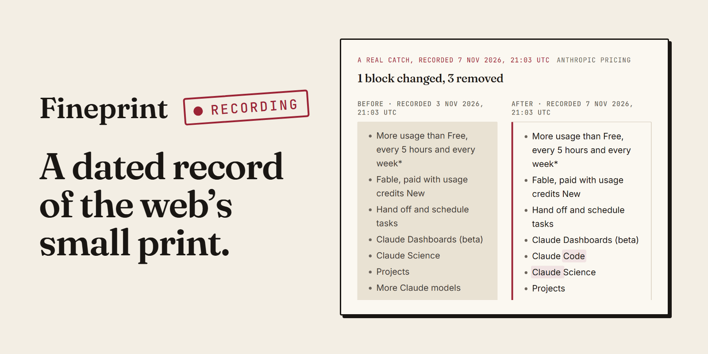

# Fineprint



A dated record of the web's small print. Fineprint watches the pages you agree to without reading: pricing, fees, terms, privacy policies, visa and baggage rules. Every real change is recorded with the date, the text and a full-page screenshot, so you can see what a page said on any day, and exactly which words changed since. Each page is watched by its own TinyFish Monitor; a change that survives the noise rules becomes a version with its text, screenshot, HTML source, summary and, for pricing pages, a price table. The site and the JSON API run from one Cloudflare Worker with D1 and R2.

## Live

https://fineprint.hamdanesmail12-7a9.workers.dev

Three clicks show the whole product:

1. [The home](https://fineprint.hamdanesmail12-7a9.workers.dev/): the change feed, the latest catch up close, and the TinyFish Time Machine bounty's requirements with live proof.
2. [Claude release notes](https://fineprint.hamdanesmail12-7a9.workers.dev/pages/233d04d4-77e6-4ebc-bc5f-15fecc07296a), the page with the most versions (6 on 8 Nov 2026): its timeline, the as-of picker that shows what the page said at any moment, each version with its screenshot, and the check log of its runs.
3. [Its largest compare](https://fineprint.hamdanesmail12-7a9.workers.dev/pages/233d04d4-77e6-4ebc-bc5f-15fecc07296a/compare?to=3a8d2ae1-b51b-4e69-8a64-edadc7278281), 4 Nov 2026 02:14 UTC to 5 Nov 2026 14:14 UTC: 23 changed blocks under the page's own headings, with word marks and both screenshots.

Recording since 3 November 2026 14:17 UTC; live figures at [/api/stats](https://fineprint.hamdanesmail12-7a9.workers.dev/api/stats).

## How TinyFish is used

| Product | What Fineprint uses it for | Where in the code |
|---|---|---|
| Monitor | Every version comes from a Monitor run. One Monitor per page, on a staggered twice-daily schedule; its webhook delivers each run, and run-now pulls a run that is overdue. | `src/tinyfish/monitor.ts`, `src/handlers/webhooks.ts`, `src/handlers/admin.ts` |
| Fetch | Validates a URL before a Monitor is created, and stores each version's HTML source. | `src/tinyfish/fetch.ts`, `src/handlers/pages.ts`, `src/capture.ts` |
| Browser | Full-page screenshot of every version, and a thumbnail of the top of the page in the same session, over raw Chrome DevTools Protocol from the Worker. | `src/tinyfish/browser.ts`, `src/capture.ts` |
| Agent | Extracts plan, fee and price facts for curated pricing and fee pages, one run at a time. | `src/tinyfish/agent.ts`, `src/capture.ts` |
| Search | Finds a site's pricing, terms, privacy and fee pages by domain (`POST /api/discover` and the watchlist's search). | `src/tinyfish/search.ts`, `src/handlers/discover.ts` |

Each service does a job nothing else in Fineprint does: without Monitor no version would exist, without Fetch no URL would be checked before it is watched and no HTML source kept, without Browser no change would have its screenshot, without Agent no pricing page would have its price table, and without Search no one could find a site's small print by its domain.

## Run locally

Needs Node 24 or later.

```bash
npm install
cp .dev.vars.example .dev.vars    # then fill in TINYFISH_API_KEY, ADMIN_TOKEN, WEBHOOK_SECRET
npm run migrate:local
npm run dev
```

```bash
npm test          # unit tests, no network: every TinyFish call is mocked
npm run check     # typecheck, tests, and wrangler deploy --dry-run (what CI runs)
```

Tests never call TinyFish. Adding a page under `npm run dev` does: it creates a real Monitor on the TinyFish account the key belongs to.

To deploy a copy of your own, follow [docs/runbook.md](docs/runbook.md). It covers the D1 database, the R2 bucket, the three secrets, the first deploy, the webhook rehearsal, registering the pages, and updating the live Worker (migrations first, then the deploy).

## How it was built and verified

**Spec and plans first.** The design is in [docs/specs/2026-11-03-fineprint-design.md](docs/specs/2026-11-03-fineprint-design.md), and the recorder and site plans are in [docs/plans/](docs/plans/). The code tasks in the plans are test-first: their tests are written and run failing before the code. What changed while building, why, and every live TinyFish call made during the build with its cost, is in [docs/build-log.md](docs/build-log.md).

The look is set in DESIGN.md and the craft rules in design/PRINCIPLES.md; the home screen was built to the comp in design/comp-home.html and the hero to design/hero.html.

**Tests.** On 8 Nov 2026 the suite has 1,148 tests in 35 files: 1,147 pass and 1 is skipped (the opt-in live screenshot test, which runs only with `FINEPRINT_LIVE=1`). `npm run check` (typecheck, the tests and `wrangler deploy --dry-run`) runs in GitHub Actions on every push and pull request ([.github/workflows/check.yml](.github/workflows/check.yml)). Apart from that opt-in test, no test reaches TinyFish: every outbound request goes through an interceptor that throws on any request it was not told to expect (`tests/helpers/fetch-mock.ts`), and the tests run with fixed test bindings, so a real key never reaches them.

**Webhook rehearsal, 3 Nov 2026.** Before any page was registered, a test Monitor was pointed at the deployed Worker on a ten-minute schedule and resumed at 14:17 UTC. TinyFish ran no scheduled check for it before it was paused again at 15:15 UTC, so no webhook arrived; the secret webhook path itself was verified live. An overdue-check fallback was therefore built before registration: when a scheduled run is overdue, the hourly job asks TinyFish to run that Monitor now (run-now) and records the run under TinyFish's run id. It was rehearsed at 16:07 UTC, and webhooks for scheduled checks began to arrive that afternoon (the UK visa page at 16:28 UTC).

**Live since 3 Nov 2026.** 20 curated pages were registered on 20 Monitors between 16:17 and 16:26 UTC ([docs/registration-log.md](docs/registration-log.md)), so the bounty's three-day minimum was met on 6 Nov 2026 16:26 UTC. On 8 Nov 2026 at 16:47 UTC, `/api/stats` read: 22 pages (20 curated and watched, 1 public, 1 retired), 225 runs (193 by webhook, 11 pulled, 21 baselines taken when a page was added), 42 versions, every one with its screenshot and HTML source, 13 real changes and 4 labelled layout-only on the pages still watched, 8 noise events suppressed, and $3.83 of TinyFish spend.

**How a version is made.**

- **Every version comes from a TinyFish Monitor run.** Fineprint never reads a page itself to find a change. A scheduled run arrives by webhook; when one is overdue (none 15 minutes after its time), the hourly job pulls it with run-now. Each version's `trigger` says which way its run came: `create` (the baseline taken when the page was added), `webhook` or `pull`. Delete the Monitors and no new version is ever created.
- **Pulls back off.** After 3 failed pulls of a page in a row (no text, a fetch error, or run-now failing), the hourly job pulls it at most once every 6 hours, until a pull returns text or a webhook arrives.
- **Noise is filtered before a version exists.** When a run's text differs from the last version's, Fineprint normalizes both texts (date and time stamps, "last updated" lines, copyright lines, cookie banners, tracking parameters, share and viewer counters) and records nothing if they match. A read much shorter than the last version that only loses content is held as a partial render, and a read that removes many blocks while adding almost none is held as a layout change; either becomes a version only when the next read agrees, within 24 hours, and the hourly job reads such a page first at its next tick. A text identical to a version recorded in the last 72 hours is a flap and is suppressed. A change that moves the same words and the same prices around is kept, but labelled layout-only. Every suppressed read stays in the page's check log with its reason.
- **Every version keeps its evidence:** the extracted text, a full-page screenshot, the HTML source, a one-line `summary` (TinyFish's own when the run carried one, `summary_source: "tinyfish"`; otherwise built from Fineprint's structured diff against the previous version, `"diff"`), its `delta` (blocks and facts added, removed and changed), and for curated pricing and fee pages the price table, labelled by `facts_status`: `ok`, `pending`, `unavailable`, `not_needed` or `paused` (the version's price-table run was not started because spending on price tables is paused at the $6 line).
- **Any page can be added at run time,** with `POST /api/pages` or the watchlist's form (a URL of at most 2,048 characters). The URL is read with TinyFetch first, so a page that cannot be read is refused with a reason instead of failing silently later.
- **Open to other sites.** The JSON API and the stored screenshots and sources answer any origin (CORS).

**Stored copies of the screens.** Measured on production on 7 Nov 2026 (`wrangler tail`, ten requests per screen), each HTML screen cost a median of 14 to 26 ms of CPU, against 2 to 3 ms for the JSON API; the cost was the render itself. Since 8 Nov 2026 05:19 UTC the home, About, the watchlist and each page's default view and default compare are served from a copy in R2 (`x-fineprint-cache: hit`). A new version drops the copies that show it, no copy is older than 24 hours, and the hourly job rebuilds the home, About and the watchlist and pre-warms the pages that changed in the last 24 hours. Measured the same way on 8 Nov 2026, a stored copy costs a median of 1 to 4 ms; a fresh render (the first visit after a change, or the rebuild's own invocation) 8 to 35 ms. Recording is not affected: webhooks and pulls render no HTML, and each rebuild runs in an invocation of its own.

## Use the data

Read endpoints are public JSON. Endpoints marked admin need `Authorization: Bearer <ADMIN_TOKEN>`.

| Method | Path | Returns |
|---|---|---|
| GET | `/api/pages` | All pages with latest version time, version count and noise count |
| GET | `/api/pages/:id` | One page, its versions (no text) and its newest 100 runs |
| GET | `/api/pages/:id/versions/:vid` | One version with its text and live URL |
| GET | `/api/pages/:id/as-of?at=ISO` | The version in force at that time |
| GET | `/api/pages/:id/diff?from=ISO&to=ISO` | Structured diff: added, removed and changed blocks, facts, the latest hop's summary |
| GET | `/api/changes?since=ISO&before=ISO&limit=&retired=0` | Feed of real changes across all pages, newest first, each with its summary; `retired=0` leaves out retired pages |
| GET | `/api/export.json` | Everything except the page texts, with absolute screenshot and source URLs |
| GET | `/api/stats` | Counts of pages, runs by trigger, versions, real and layout-only changes, noise by reason, spend by kind, monitor health, public slots, the recording start, the two spend pauses |
| GET | `/shots/:name`, `/thumbs/:name`, `/sources/:name` | The stored screenshot, thumbnail and HTML source of a version |
| POST | `/api/pages` | Add a page. Without the admin token: 4 public slots, 1 add per visitor per day, removed after 7 days |
| POST | `/api/discover` | `{domain}`: find that site's pricing, terms, privacy and fee pages |
| PATCH | `/api/pages/:id` | Admin: label, kind, ignore patterns, schedule, purpose, promote to curated |
| DELETE | `/api/pages/:id` | Admin: deletes the Monitor, keeps the history |
| POST | `/api/admin/pages/:id/retire` | Admin: deletes the Monitor, marks the page `retired`, keeps the history |
| POST | `/api/admin/pull/:pageId` | Admin: run the page's Monitor now and record the run, marked `pull` (what the hourly job does for an overdue check) |
| POST | `/api/pages/:id/replay` | Admin: run the change gate again over the stored raw runs; `?would_now_be=1` also judges runs that already have a version |
| POST | `/api/admin/rotate-webhook` | Admin: re-point every live Monitor at `{base_url}` |
| POST | `/api/admin/backfill-summaries` | Admin: fill missing summaries, `{filled, remaining}`; call until `remaining` is 0 |
| POST | `/api/admin/backfill-deltas` | Admin: fill missing deltas and the layout-only label; the hourly job calls it while any is missing |
| POST | `/api/admin/thumbs?limit=` | Admin: make missing thumbnails from stored screenshots, `{made, remaining}` |
| POST | `/api/admin/warm-diff?version=` | Admin: compute and store the diff of a version and the one before it (the hourly job does this for large pages) |
| POST | `/api/admin/rebuild-html?key=` | Admin: render one screen fresh and store its copy (the hourly job's rebuild) |

Every version has the same fields wherever it appears (`/api/pages/:id`, the export, versions/:vid and as-of, which add `text` and `live_url`): `id`, `page_id`, `captured_at`, `is_baseline`, `summary`, `summary_source`, `judgment_summary` (TinyFish's text as it came), `facts`, `delta`, `screenshot_url`, `source_url`, `thumb_url`, `capture_status`, `facts_status`, `trigger` and `notes` (why a version exists when it is not the plain result of one read: a confirmed suspect read, or a replay).

TinyFish calls `POST /hooks/monitor/<secret>` on every scheduled run, and `POST /hooks/agent/<secret>` when a price-table run finishes. Those paths are not part of the public API.

## Limits and posture

- **No history before a page is added.** Fineprint records from its first read of a page, the baseline. It cannot say what a page said before that.
- **Each page is checked twice a day.** A change is dated to the check that found it, which can be up to about twelve hours after the page itself changed.
- **Recording paused on 8 Nov 2026 at 17:30 UTC.** Once the entry was ready to submit (it went in on 9 Nov 2026), the 20 curated Monitors were paused at TinyFish and their pages marked paused, to hold the TinyFish spend at $3.83; nothing was deleted, and every version, screenshot, source, diff and check log stays and is shown. A paused Monitor is not resumed (a resumed Monitor cannot be relied on to run again, which the webhook rehearsal showed). Stripe pricing, the one public page, stays active until it expires on 14 Nov 2026, and any page added through the watchlist starts a new Monitor of its own for seven days, so the recorder itself is unchanged. `/api/stats` shows it as `monitors.active` 1 and `monitors.paused` 20.
- **A small, fixed budget.** At $6 of total TinyFish spend, no new price-table run starts; price tables are most of the spend ($2.61 of the $3.83 on 8 Nov 2026 16:47 UTC). At the rate of the first five days ($0.79 on 3 Nov 2026 17:06 UTC, $3.83 on 8 Nov 2026 16:47 UTC) that line falls around 12 Nov 2026. A version recorded after it whose price table could not be read says: "Price table not read: spending on price tables is paused at the $6 line. The change itself is recorded, with its screenshot and diff." At $8, Fineprint starts nothing more that costs money on its side (no overdue-check pull, screenshot, stored source, price table or new page), while the Monitors' own scheduled checks continue and a change they report is still kept as a version, without its screenshot. `/api/stats` shows both lines as `facts_paused` and `spend_paused`.
- **DEWA slab tariff has no price table.** Both of its price-table runs, on 6 Nov 2026, completed with an empty list, so its facts are `unavailable`; its text, screenshot and source are recorded as for any page.
- **One page retired for unreliable reads.** OpenAI API pricing rendered differently from one read to the next (a short table one time, the full table another), which made false versions, so it was retired on 6 Nov 2026 at 18:42 UTC and DEWA slab tariff took its place. Its Monitor was deleted; its versions, runs, screenshots and sources are kept and still shown.
- **Layout-only changes are labelled, never hidden.** The version, its screenshot and its diff stay in the feed and the history; the label only keeps it out of the count of real changes (4 labelled on 8 Nov 2026 16:47 UTC).
- **Public pages expire after 7 days.** Anyone can add a page to one of 4 public slots, one per visitor per day. A public page never gets a price table. After 7 days its Monitor is deleted and the page is marked expired; its history is kept. The first public add, Stripe pricing, was made through the site on 7 Nov 2026 at 14:19 UTC with an expiry of 14 Nov 2026 14:20 UTC.
- **Free Workers plan, stored copies of the screens.** Fineprint runs on Cloudflare's free Workers plan. The home, About and the watchlist are served from a copy rebuilt every hour and whenever a new version is recorded, so their counts and the recording or paused state can trail by up to an hour; `/api/stats` is always live.
- **Headers.** Every HTML screen is sent with a Content-Security-Policy (`default-src 'self'`, scripts only from its own origin, `form-action 'self'`, `frame-ancestors 'none'`), `X-Content-Type-Options: nosniff` and `Referrer-Policy: strict-origin-when-cross-origin`. Stored screenshots and sources are served with `Content-Security-Policy: sandbox` and `nosniff`.
- **Secrets.** The TinyFish key, the admin token and the webhook secret live only in `.dev.vars` locally and as Worker secrets in production. The webhook path carries its own secret, compared in constant time, and no error message or log line echoes a key or the webhook URL.
- **What Fineprint never does.** It never reads a page itself to find a change; only Monitor runs make versions. It never deletes history: deleting, retiring or expiring a page deletes its Monitor and keeps every version, run and stored file. It never runs a stored page's scripts on its own origin: a stored source is served sandboxed.

## License

MIT. See [LICENSE](LICENSE).
